<p align="center">
  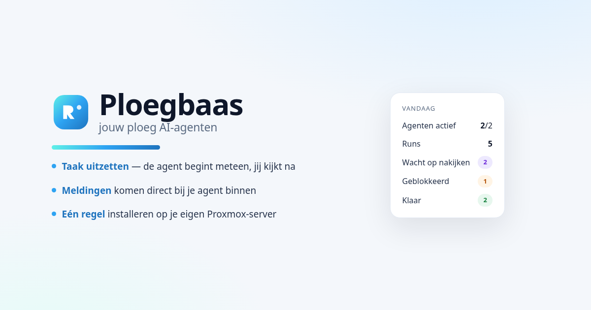
</p>

<h1 align="center">Ploegbaas</h1>

<p align="center">
  Eigen dashboard om een <b>ploeg AI-agenten</b> aan het werk te zetten.<br>
  Je zet een taak uit, de agent begint meteen, jij kijkt het na.
</p>

<p align="center">
  
  
  
  
  
  
</p>

<p align="center">
  <a href="docs/ploegbaas-rondleiding.mp4">
    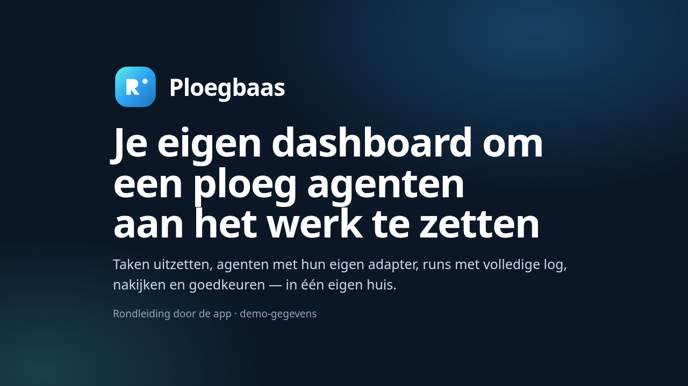
  </a>
  <br>
  <sub>Klik op het beeld voor de <b>rondleiding van 55 seconden</b> door de app — met Nederlandse
  voice-over en een rustige muziekbed (MP4, 1280×720, demo-gegevens).</sub>
</p>

Alles in het Nederlands, met een eigen huisstijl. Eén Node-server (`node:http`,
`node:sqlite`, `node:child_process`) en één pagina HTML: **geen
npm-afhankelijkheden, geen framework**. Functioneel geïnspireerd op Paperclip (MIT,
paperclipai/paperclip) — er is **geen regel code uit dat project overgenomen**; zie
"Herkomst" onderaan.

---

## Wat je ziet

| | |
|---|---|
| 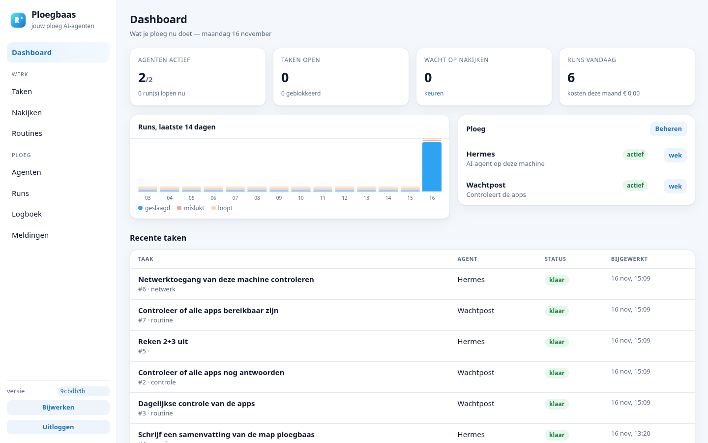 | 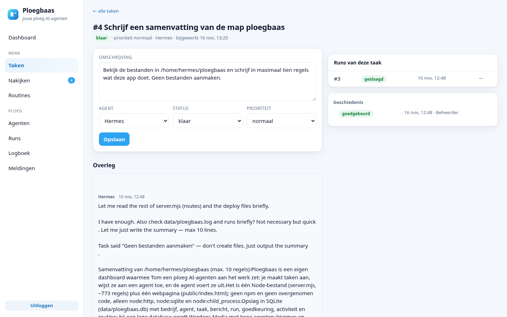 |
| **Dashboard** — hoeveel agenten er lopen, wat er vandaag gebeurde, en wat op jouw oordeel wacht. | **Een taak** — het overleg met de agent, de runs die erbij horen en het nakijk-paneel. |
| 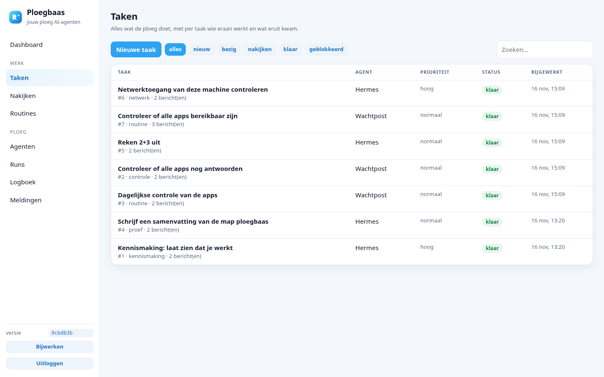 | 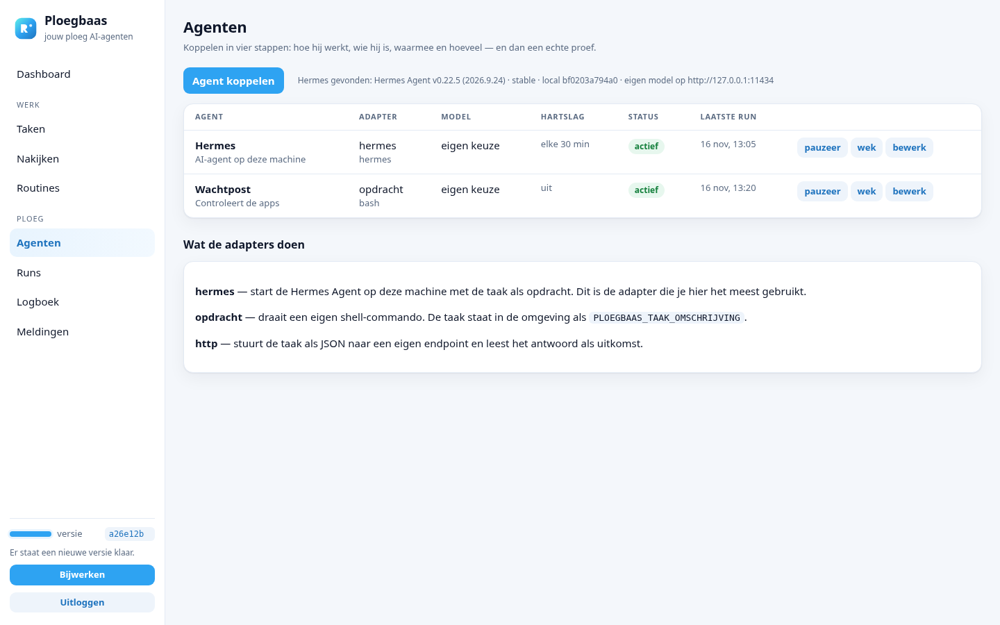 |
| **Taken** — filter op status, zoek, en zie meteen wie waaraan werkt. | **Agenten** — per agent een adapter, een model, een hartslag en een budget. |

<details>
<summary><b>Meer schermafbeeldingen</b> — runs, routines, meldingen, logboek, nakijken, inloggen</summary>

| | |
|---|---|
| 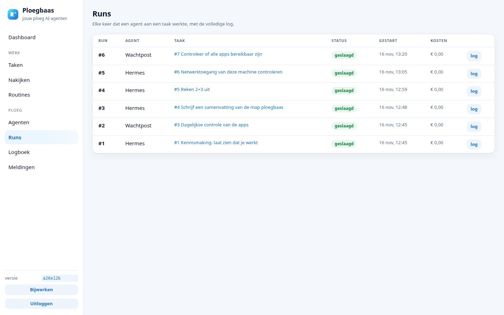 | 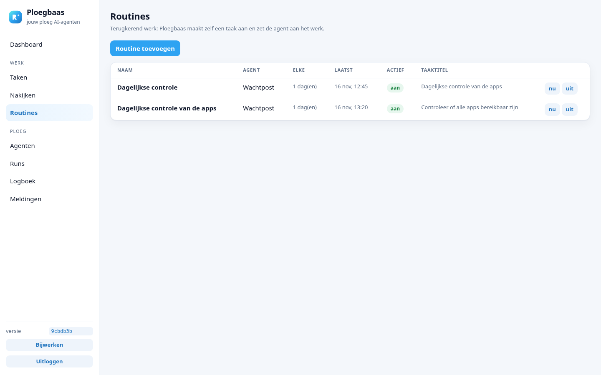 |
| **Runs** — elke uitvoering met de volledige log, live bijgewerkt. | **Routines** — terugkerend werk dat zelf taken aanmaakt. |
| 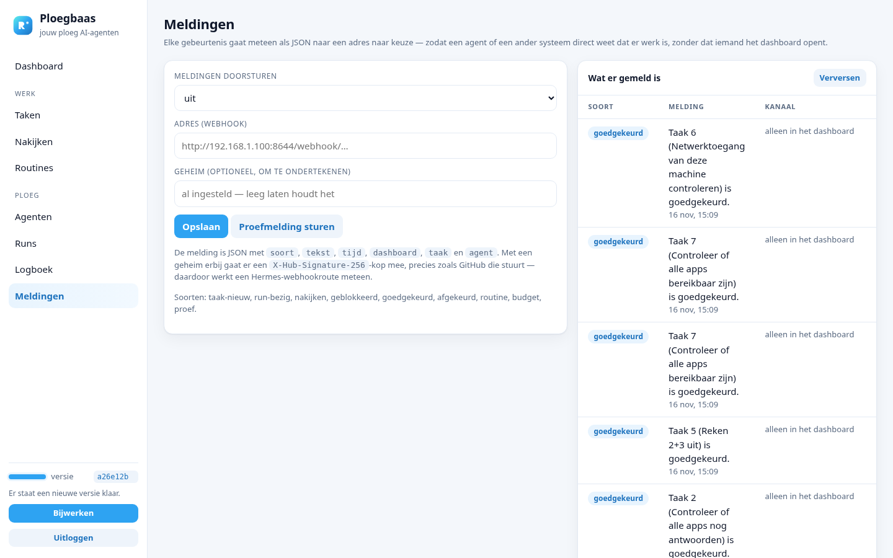 | 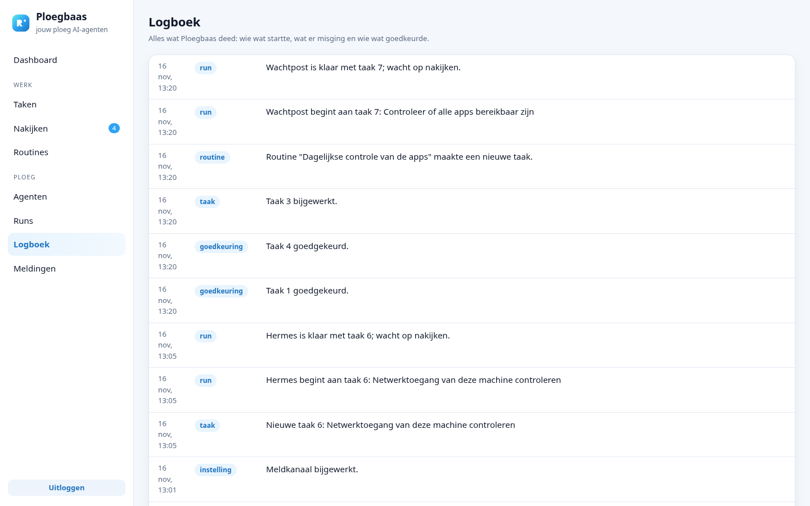 |
| **Meldingen** — het meldkanaal en wat er verstuurd is. | **Logboek** — wie wat startte, wat misging en wie wat goedkeurde. |
| 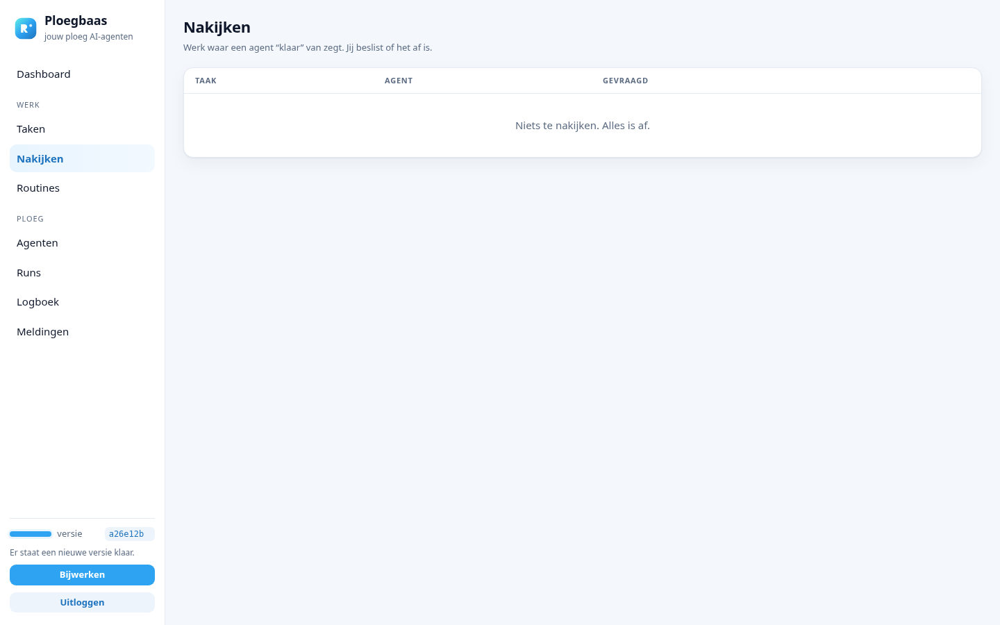 | 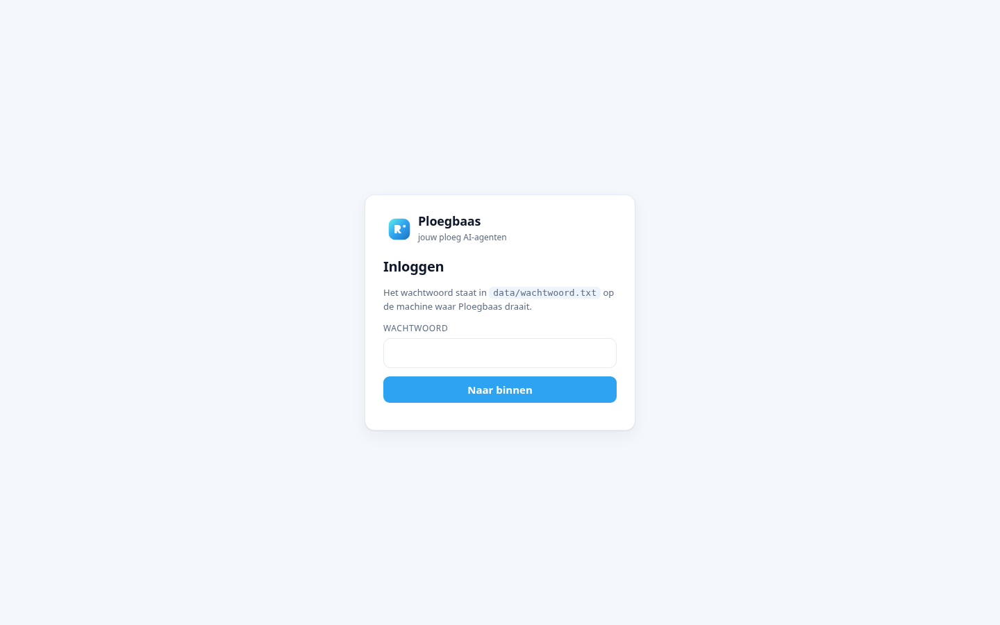 |
| **Nakijken** — werk waar een agent "klaar" van zegt. | **Inloggen** — één wachtwoord, ondertekende sessiecookie. |

</details>

## Zo werkt het

1. **Taak** — je schrijft op wat er moet gebeuren en wijst hem toe aan een agent.
2. **Hartslag** — elke 15 seconden kijkt Ploegbaas of een agent werk heeft. Is er
   een open taak, dan start hij een **run** en zet de taak op *bezig*. Een nieuwe
   taak of een goedkeuring wacht niet op die tik, maar gaat direct door.
3. **Uitvoering** — de agent draait via zijn **adapter**:
   - `hermes` — start de Hermes Agent op deze machine met de taak als opdracht;
   - `opdracht` — draait een eigen shell-commando (de opdracht staat in de omgeving);
   - `http` — stuurt de taak als JSON naar een eigen endpoint.
4. **Nakijken** — een geslaagde run zet de taak op *nakijken* en maakt een
   goedkeuring aan. Jij keurt goed, of stuurt hem terug naar de agent met uitleg.
5. **Logboek** — elke start, uitkomst, goedkeuring en fout staat in het logboek.

Daarnaast: **routines** (terugkerend werk dat zelf taken aanmaakt), **budgetten**
(een agent wordt automatisch gepauzeerd als zijn maandbudget op is), en een **live
kanaal** zodat de pagina zichzelf bijwerkt terwijl een agent bezig is.

## Bijwerken vanaf het dashboard

Onderaan de zijbalk staat de versie die draait, en een knop **Bijwerken**. Zodra er op
GitHub een nieuwe versie staat, verschijnt daar een blauwe stip met "Er staat een nieuwe
versie klaar" — dan is één klik genoeg.

Wat de knop doet (via `deploy/bijwerken.sh`):

1. haalt de nieuwste code van GitHub (`codeload`-tarball van de tak, standaard `main`);
2. controleert dat de nieuwe `server.mjs` door `node --check` komt — zakt hij, dan blijft
   de huidige versie staan en gebeurt er verder niets;
3. bewaart de huidige code in `ploegbaas/.vorige/`, vervangt `server.mjs`, `public/`,
   `scripts/` en `deploy/`, en laat `data/` met rust (taken, agenten, runs, wachtwoord);
4. herstart de service en wacht tot `/api/gezondheid` antwoordt;
5. komt de nieuwe versie niet op, dan zet het script **zelf de vorige terug** en herstart
   opnieuw — je houdt dus altijd een werkend dashboard.

De pagina toont de hele log tijdens het bijwerken en ververst zichzelf zodra het klaar is.
Met de knop **Vorige versie terug** draai je de laatste wijziging terug.

Ook zonder de pagina:

```bash
bash deploy/bijwerken.sh            # bijwerken en herstarten
DROOG=1 bash deploy/bijwerken.sh    # halen en controleren, niets aanraken
bash deploy/bijwerken.sh --terug    # de vorige versie terugzetten
```

Bijwerken heeft internet naar `github.com` nodig; staat de machine zonder netwerk, dan
zegt het paneel dat de nieuwste versie niet op te halen is en blijft de knop staan.

API: `GET /api/versie` (wat draait, wat er is, of er iets nieuws is), `POST /api/bijwerken`,
`POST /api/bijwerken/terug`, `GET /api/bijwerken/log` (de log van de lopende of laatste
bijwerking).

## Meldingen: de agent weet het meteen

Er zijn twee kanten aan "meteen":

1. **Meteen beginnen.** Een nieuwe taak (of een goedkeuring die teruggaat naar de agent,
   of een bericht in de thread) wordt niet pas bij de volgende hartslag opgepakt, maar
   direct daarna — gemeten: **0,5 seconde** in plaats van maximaal 15.
2. **Meteen doorgeven.** Elke gebeurtenis gaat als JSON naar een **meldkanaal** dat je
   zelf instelt op de pagina *Meldingen*. Zo weet een agent — of welk systeem dan ook —
   dat er werk is, ook als er niemand naar het dashboard kijkt.

Het bericht ziet er zo uit:

```json
{
  "soort": "taak-nieuw",
  "tekst": "Nieuwe taak 7: controleer de website",
  "tijd": "2026-11-16T12:00:00.000Z",
  "dashboard": "http://192.168.1.100:8123",
  "taak": { "id": 7, "titel": "controleer de website", "status": "nieuw", "prioriteit": "hoog" },
  "agent": { "id": 1, "naam": "Hermes", "rol": "algemeen" }
}
```

Soorten: `taak-nieuw`, `run-bezig`, `nakijken`, `geblokkeerd`, `goedgekeurd`, `afgekeurd`,
`routine`, `budget` en `proef`. Vul je een **geheim** in, dan gaat er een
`X-Hub-Signature-256`-kop mee (HMAC-SHA256 over precies de verzonden tekst, zoals GitHub
die stuurt) — daardoor accepteert een Hermes-webhookroute de melding zonder extra werk:

```bash
hermes webhook subscribe ploegbaas \
  --prompt "Ploegbaas meldt: {tekst} (soort {soort}, dashboard {dashboard})" \
  --deliver slack
```

Het adres dat je daarbij terugkrijgt vul je in bij *Meldingen* → Adres, met hetzelfde
geheim. Elke melding is dan een nieuwe opdracht voor de agent.

## Snel starten

```bash
node --no-warnings server.mjs          # standaard op poort 8123, poort instelbaar
```

### Op een Proxmox-server, met één regel

Op de host, als root:

```bash
bash -c "$(curl -fsSL https://raw.githubusercontent.com/Theberas04/ploegbaas/main/deploy/proxmox/install.sh)"
```

Dat maakt een unprivileged Debian-container, zet Ploegbaas erin als service, installeert de
Hermes Agent erbij (de agent die het werk doet) en zet het meldkanaal klaar. Eerst kijken
zonder iets aan te maken: zet `DROOG=1` ervoor. Bijsturen kan met `CORES`, `MEMORY`, `DISK`,
`STATIC_IP`/`GATEWAY`, `PLOEGBAAS_POORT`, `PLOEGBAAS_MELDWEBHOOK` en — voor je eigen model —
`PLOEGBAAS_LLM_URL` + `PLOEGBAAS_LLM_MODEL`:

```bash
CORES=4 MEMORY=8192 STATIC_IP=192.168.1.100/24 GATEWAY=192.168.1.1 \
  PLOEGBAAS_LLM_URL=http://192.168.1.100:11434/v1 PLOEGBAAS_LLM_MODEL=Llama-3.2-3B-Instruct-Q4_K_M \
  bash -c "$(curl -fsSL https://raw.githubusercontent.com/Theberas04/ploegbaas/main/deploy/proxmox/install.sh)"
```

Het wachtwoord wordt de eerste keer aangemaakt en staat in `data/wachtwoord.txt`.
Open daarna `http://<adres>:8123` en log in. Bij een lege database richt Ploegbaas
zichzelf in met een bedrijf, twee agenten en een paar taken, zodat je meteen ziet
hoe het werkt.

Instellen met omgevingsvariabelen: `PLOEGBAAS_POORT` (standaard 8123),
`PLOEGBAAS_DATA` (standaard `./data`), `PLOEGBAAS_WACHTWOORD` (anders gegenereerd).

Controle dat alles staat:

```bash
node --no-warnings server.mjs controleer
```

Als service (start ook na een reboot):

```bash
sudo cp deploy/systemd/ploegbaas.service /etc/systemd/system/   # in een container/VM
sudo systemctl enable --now ploegbaas
```

Wil je de Hermes-adapter gebruiken, dan moet de Hermes Agent op die machine staan
(`curl -fsSL https://hermes-agent.nousresearch.com/install.sh | bash`). Zonder
Hermes werken de adapters `opdracht` en `http` gewoon.

## De agent in het netwerk

De kit installeert de Hermes Agent **in de container**, en die draait daar met volledige
rechten. De agent kan dus alles wat je op die machine kunt: bestanden schrijven, diensten
herstarten, andere machines op je netwerk benaderen met `curl`/`ssh`, en repositories
bijwerken.

De kit maakt daarvoor **zelf een sleutel** in de container (`/root/.ssh/id_ed25519`) en zet
een `~/.ssh/config` neer die nooit blijft hangen op een hostsleutelvraag — anders wacht een
agent midden in een taak op een "yes/no" die niemand kan beantwoorden. De publieke helft
moet één keer per machine in `~/.ssh/authorized_keys` staan; het inrichtscript print hem
aan het eind:

```bash
cat /root/.ssh/id_ed25519.pub        # in de container; plak die regel op de andere machine
```

**Pingen** zet de kit ook goed. Een unprivileged container mag geen ICMP (`cap_net_raw`) en
de `ping` van Debian is niet setuid, dus elke ping eindigt in *Operation not permitted* —
dat lijkt op een netwerkstoring die er niet is. De kit zet daarom
`net.ipv4.ping_group_range = 0 2147483647` (ook in `/etc/sysctl.d/90-ploegbaas-ping.conf`,
dus na een herstart nog steeds). In een container die er al stond is dat één regel:

```bash
sysctl -w net.ipv4.ping_group_range="0 2147483647"
echo 'net.ipv4.ping_group_range = 0 2147483647' > /etc/sysctl.d/90-ploegbaas-ping.conf
```

Zonder die regel werkt alles nog steeds — alleen bereikbaarheid toets je dan met TCP
(`check-` en `diagnose-ploegbaas.sh` doen dat ook) in plaats van met ping.

Wat je zelf in de hand houdt: de agent werkt alleen aan taken die in het dashboard staan
(of die via een routine of een melding binnenkomen), en alles wat hij doet staat in het
logboek en in de run-logs. Zet Ploegbaas daarom **niet** rechtstreeks op internet — het is
een dashboard met één wachtwoord en een agent met volledige rechten. Op een vertrouwd
netwerk achter een VPN is het bedoeld zoals het is.

## Wat er wel en niet in zit

Eerlijke functielijst. **ja** = werkt hier · **deels** = aanwezig met een beperking ·
**nee** = niet gebouwd.

| Functie | Hier | Toelichting |
|---|---|---|
| Dashboard met inlogwachtwoord | ja | Eén wachtwoord, ondertekende sessiecookie; de API geeft 401 zonder sessie |
| Taken met status, prioriteit, labels en ouder-taak | ja | *nieuw · bezig · nakijken · klaar · geblokkeerd* |
| Overleg per taak (thread) met de agent | ja | Een bericht van jou zet de taak terug op *nieuw* |
| Agenten met rol, titel en adapter | ja | `hermes`, `opdracht`, `http` |
| Hartslag: agent pakt zelf toegewezen werk | ja | Elke 15 seconden; één run per agent tegelijk |
| Runs met volledige log en live bijwerken | ja | Logbestand per run plus een live kanaal (SSE) in de pagina |
| Meldingen meteen doorgeven aan een webhook | ja | JSON per gebeurtenis, optioneel ondertekend (HMAC-SHA256); de pagina Meldingen toont wat er verstuurd is |
| Werk meteen oppakken, zonder wachttijd | ja | Nieuwe taak of goedkeuring start de agent direct (~0,5 s) in plaats van bij de volgende hartslag |
| Installatie op een Proxmox-server met één regel | ja | `deploy/proxmox/install.sh`: container, service, Hermes Agent erbij en het meldkanaal klaar |
| Bijwerken vanaf het dashboard | ja | Knop in de zijbalk: haalt de nieuwste versie, controleert haar, bewaart de oude in `.vorige/`, herstart en zet bij een mislukking zichzelf terug |
| Nakijken en goedkeuren | ja | Goedkeuren of terugsturen met opmerking |
| Routines (terugkerend werk) | ja | Interval in minuten, met een knop om er nu één te starten |
| Budgetten met harde stop | deels | Je vult een maandbudget in en Ploegbaas pauzeert de agent als het op is; kosten per run zijn **handmatig** (er is nog geen prijstabel per model) |
| Logboek en audittrail | ja | Elke mutatie en run |
| Meerdere bedrijven | deels | De tabel staat er en de API kan het; de pagina toont nu één bedrijf |
| Org-chart met rapportagelijnen | nee | Rollen en titels zijn er, een hiërarchie nog niet |
| Meerdere mensen met eigen accounts en rechten | nee | Bewust één beheerder met één wachtwoord |
| Skills, evaluaties, teamtemplates | nee | Nog niet gebouwd |
| Connectors (GitHub, Notion, MCP) en chat-kanalen | nee | De `http`-adapter is het haakje voor eigen koppelingen |
| Zoeken over alles heen | deels | Zoeken in de takenlijst; niet over logs en berichten |
| Mobiel bruikbaar | ja | Responsieve pagina, dus bruikbaar vanaf je telefoon op het netwerk |

## Bestanden

```
server.mjs                        de hele server: API, hartslag, adapters, uitvoering, logboek
public/index.html                 de hele pagina (HTML + CSS + JavaScript, geen bouwstap)
deploy/systemd/                   service-eenheid voor een container of VM
deploy/proxmox/                   de installatiekit: one-liner, container, inrichten, controle, diagnose
deploy/bijwerken.sh               bijwerken vanaf het dashboard (of vanaf de opdrachtregel)
scripts/in-beeld.js               maakt de schermafbeeldingen, de kaarten en de videoframes
scripts/maak-video.py             zet de rondleiding in elkaar: beeld, stem en muziekbed
docs/kaarten.html                 de bron van de omslag, de titelkaart en de slotkaart
docs/ploegbaas-rondleiding.mp4    de rondleiding (55 s, 1280×720, met voice-over)
docs/screenshots/                 alle schermafbeeldingen uit deze README
data/                             database, wachtwoord, run-logs (horen niet in git)
```

De database is één SQLite-bestand (`data/ploegbaas.db`) met de tabellen `bedrijf`,
`agent`, `taak`, `bericht`, `run`, `goedkeuring`, `activiteit`, `routine`,
`instelling` en `melding`. Een back-up is het bestand kopiëren.

### Het beeldmateriaal opnieuw maken

Na een wijziging aan de pagina zijn de afbeeldingen en de video een paar commando's:

```bash
node scripts/in-beeld.js --modus stills   # docs/screenshots/*.png op 1440×900
node scripts/in-beeld.js --modus platen   # omslag, titelkaart en slotkaart
node scripts/in-beeld.js --modus video    # tmp-video/frames.txt met de echte tijden
ffmpeg -y -f concat -safe 0 -i tmp-video/frames.txt \
  -vf 'scale=1280:672,setsar=1,fps=30' -c:v libx264 -preset medium -crf 17 \
  -pix_fmt yuv420p tmp-video/inhoud.mp4
python3 scripts/maak-video.py             # titelkaart + beeld + slotkaart, met stem en muziek
```

`scripts/in-beeld.js` logt in via het inlogformulier, loopt de schermen langs, en stopt met
een foutmelding — inclusief de JS-fouten en de laatste API-antwoorden — als een scherm niet
verschijnt. `scripts/maak-video.py` rekent uit hoelang elk scherm in beeld blijft: het rekt
een scherm op tot de ingesproken zin erin past, zodat de stem nooit over het volgende
scherm heen valt. De ingesproken zinnen staan in `tmp-video/stem/n01..n10.mp3` (buiten git);
maak ze opnieuw met de tekst uit `scripts/maak-video.py`.

## Herkomst en licentie

Ploegbaas is eigen werk van Werdens Media: de server, de pagina, de adapters, de
hartslag en de goedkeuringslus zijn hier geschreven. De **functionaliteit** is
geïnspireerd op het MIT-gelicenseerde [paperclipai/paperclip](https://github.com/paperclipai/paperclip)
(een dashboard om agentteams aan te sturen); er is **geen code, bestandsindeling,
endpointnaam of schermtekst uit dat project overgenomen**. Draai je liever het
origineel, gebruik dan de kit daarvoor.

© Werdens Media — alle rechten voorbehouden.